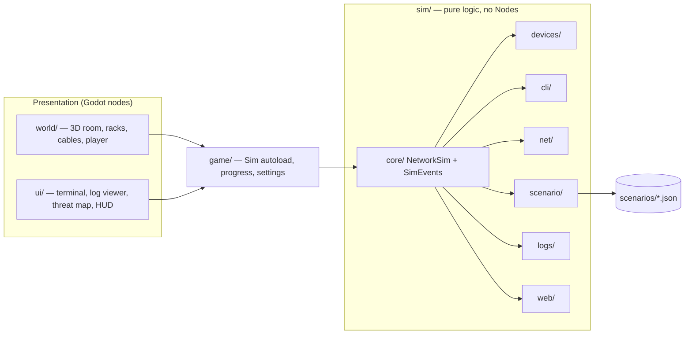

# netsec-3d-simulator

A first-person 3D game made in Godot 4 that teaches CCNA-level networking and
entry-level security by having you do the work. You walk around a server room,
plug in cables, and fix broken networks and insecure servers from an
IOS-style terminal.

Under the game is a deterministic network engine with unit tests, an IOS-style
command parser, and missions written as JSON files.

> **Status: pre-alpha, design phase.** The repo currently holds the design spec
> and implementation plan, but no game code yet. The setup and run steps below
> describe how the project will work once milestone M0 (project setup) is
> done. Progress is tracked in
> [`docs/IMPLEMENTATION_PLAN.md`](docs/IMPLEMENTATION_PLAN.md).

---

## Contents

- [What you do in the game](#what-you-do-in-the-game)
- [Missions](#missions)
- [Requirements](#requirements)
- [Setup](#setup)
- [Running the game](#running-the-game)
- [Controls](#controls)
- [Using the terminal](#using-the-terminal)
- [Running the tests](#running-the-tests)
- [Exporting builds](#exporting-builds)
- [Architecture](#architecture)
- [Project layout](#project-layout)
- [Writing a mission](#writing-a-mission)
- [Roadmap](#roadmap)
- [Contributing](#contributing)
- [License](#license)

---

## What you do in the game

- **Cable the network.** Pick up a cable end, look at a port and plug it in.
  Port LEDs show the link state: off means no cable, amber means cabled but
  down, and green means up.
- **Configure devices.** Open a console on a router or switch and type real
  IOS-style commands: `conf t`, `int g0/0.10`, `encapsulation dot1Q 10`,
  `sh ip int br`. Abbreviations, `?` help, Tab completion and `no` work the
  way they do on Cisco gear.
- **Test your fixes.** Ping from routers, switches and PCs. If the ping fails,
  the game knows exactly why (no link, an interface shut down, a VLAN
  mismatch, no route, a wrong gateway, and so on). If you press the hint key,
  it gives you a hint matched to that reason.
- **Investigate and patch.** Read server logs to find an attacker, file an
  incident report, then exploit and patch vulnerable web code from inside the
  game.

Every mission starts broken. Nothing you do reaches a real network: all
packets, HTTP and logs are simulated.

## Missions

| # | Mission | You learn |
| --- | --- | --- |
| 1 | **Day One: Get Them Talking** | VLANs, access and trunk ports, router-on-a-stick |
| 2 | **Who Knocked?** | Reading auth and web logs, spotting a brute-force attack, writing an incident report |
| 3 | **Patch Tuesday** | Exploiting and fixing SQL injection and reflected XSS |

Planned after v1: **Remote access and routing** (SSH, static routes) and
**NAT and ACLs**.

Missions unlock in order. Each one has a briefing at the start, objectives
that tick off live as you work, optional hints, and a debrief at the end that
shows what was fixed and the commands a real admin would use.

## Requirements

**To play:**

- Windows, Linux, or a modern browser (Chrome or Firefox) for the web build
- Built for low-end hardware: Intel HD Graphics 4000-class GPU, 2 GB RAM
- Target: 60 fps at 1280×720

**To develop:**

- [Godot 4.7, Standard edition](https://godotengine.org/download) (not the
  .NET edition; the project uses GDScript only)
- Git
- [GdUnit4](https://github.com/MikeSchulze/gdUnit4) for tests (it will be
  included under `addons/gdUnit4`)
- Optional: Godot export templates for 4.7, if you want to build exports

## Setup

1. **Install Godot 4.7.**
   - Download the Standard build for your OS from
     [godotengine.org](https://godotengine.org/download).
   - On Linux, put the binary on your `PATH`, for example:

     ```sh
     mv Godot_v4.7-stable_linux.x86_64 ~/.local/bin/godot
     chmod +x ~/.local/bin/godot
     ```

2. **Clone the repo.**

   ```sh
   git clone https://github.com/jimjamscott22/netsec-3d-simulator.git
   cd netsec-3d-simulator
   ```

3. **Import the project.** Either open Godot's Project Manager, click
   **Import** and select `project.godot` at the repo root, or run:

   ```sh
   godot --editor --path .
   ```

   The first import builds the `.godot/` cache. That folder is gitignored, so
   don't commit it.

4. **Check that the GdUnit4 plugin is enabled.** In the editor, go to
   **Project → Project Settings → Plugins**.

The project uses the **Compatibility** renderer so that it runs on older GPUs
and in the browser. Don't switch it to Forward+.

## Running the game

**From the editor:** open the project and press **F5** (Run Project). The
game starts at the main menu. Pick a mission to start.

**From the command line:**

```sh
godot --path .
```

**Progress** (which missions you've finished, plus your settings) is saved to
`user://progress.json`. Where that file lives depends on your OS:

| OS | Path |
| --- | --- |
| Linux | `~/.local/share/godot/app_userdata/<project name>/` |
| Windows | `%APPDATA%\Godot\app_userdata\<project name>\` |

Delete it to reset your progress. In v1, a mission's in-progress state isn't
saved: if you leave a mission, it restarts the next time you open it.

## Controls

| Action | Key |
| --- | --- |
| Move | W A S D |
| Look | Mouse |
| Interact (pick up/plug cable, open console) | E or left click |
| Cancel / close terminal | Esc |
| Show hint | H |
| Toggle objectives | Tab (outside the terminal) |
| Crouch | Ctrl |

**Cabling:**

1. Look at a free port and press **E** to pick up a cable end.
2. Look at a second free port and press **E** again to plug it in.

To unplug a cable, press **E** on it. Some cables are locked in place by the
mission and can't be unplugged. Ports with a dust cap are reserved and can't
take a cable. The HUD shows how many spare cables you have left.

## Using the terminal

Interact with a device's console port, or with a PC screen, to open a
full-screen terminal.

**Routers and switches** use an IOS-style CLI:

```text
Router> en
Router# conf t
Router(config)# int g0/0
Router(config-if)# no shut
Router(config-if)# int g0/0.10
Router(config-subif)# encapsulation dot1Q 10
Router(config-subif)# ip address 192.168.10.1 255.255.255.0
Router(config-subif)# end
Router# sh ip int br
Router# ping 192.168.20.10
```

- Unique abbreviations work (`sh ip int br`). Type `?` for help, press Tab to
  complete a word, and press Up/Down to move through your command history.
- `do` runs an exec-mode command from config mode, and Ctrl+Z works like `end`.
- The commands supported in each mission are listed in
  [`.claude/skills/netsec-sim/references/ios-cli.md`](.claude/skills/netsec-sim/references/ios-cli.md).

**PCs** have a small Windows-style shell: `ipconfig`, `ping <ip>`,
`curl <url>` (mission 3) and `help`.

**Servers** have a small Linux-style shell: `ls`, `cat`, `grep [-i]`,
`tail [-n N]`, `service <name> status`, `edit <file>` (mission 3) and `help`.

## Running the tests

The network engine (`sim/`) has unit tests written with GdUnit4. The tests run
headless, with no window or GPU needed.

```sh
# All tests (Linux/macOS)
addons/gdUnit4/runtest.sh -a res://tests

# All tests (Windows)
addons\gdUnit4\runtest.cmd -a res://tests

# A single suite or folder (example; test folders mirror the sim/ folders)
addons/gdUnit4/runtest.sh -a res://tests/net/test_resolver.gd
```

The runner needs to find Godot. If `godot` isn't on your `PATH`, set
`GODOT_BIN` to the path of your Godot binary. If the runner's location or
flags differ in your GdUnit4 version, check the GdUnit4 docs.

**Purity check.** The engine under `sim/` must stay pure logic: no scene
nodes, input, clock, timers or randomness. This script fails if any of those
show up:

```sh
tools/check_sim_purity.sh
```

**CI.** GitHub Actions runs on every push and pull request. It imports the
project headless on Ubuntu, then runs the purity check, then runs the full
test suite.

What the tests cover:

- Address and interface-name helpers
- Every CLI command: parsing (including abbreviations), state changes, and
  `show` output against exact expected strings
- Connectivity: same-subnet pings with no router, router-on-a-stick, and
  every ping failure reason
- Every objective type, with passing and failing cases
- A smoke test for every mission: it loads the mission, checks that it starts
  broken, applies the known solution, and checks that every objective passes

## Exporting builds

Install the Godot 4.7 export templates first (**Editor → Manage Export
Templates**). Then either export from **Project → Export**, or run:

```sh
godot --headless --path . --export-release "Linux"   build/linux/netsec.x86_64
godot --headless --path . --export-release "Windows" build/windows/netsec.exe
godot --headless --path . --export-release "Web"     build/web/index.html
```

The preset names must match the ones in `export_presets.cfg`.

To test the web build locally, serve the folder over HTTP. Opening the file
directly with `file://` won't work:

```sh
python3 -m http.server --directory build/web 8000
```

Then open <http://localhost:8000> in your browser. This simple server works
only if the Web export preset has thread support turned off. With threads on,
the server must send cross-origin isolation headers
(`Cross-Origin-Opener-Policy` and `Cross-Origin-Embedder-Policy`).

Release builds for all three platforms are planned to be built by CI on each
version tag and attached to a GitHub release.

## Architecture

The game is split into two layers, and dependencies only point inward:



- **The sim core (`sim/`) is pure and deterministic.** The same state and the
  same input always give the same output. It doesn't use scene nodes, the
  clock or randomness, which means it can run headless in tests and could
  later be swapped for a real backend.
- **No real packets.** `ping` is a deterministic path search over the current
  network state. It checks each layer in order: physical links, the next-hop
  decision, Layer 2 paths within a VLAN, and the router pipeline. The reply
  path must also work. A failed ping reports the first problem it found, and
  mission hints are chosen from that.
- **The `Sim` autoload is the only bridge** between the core and the rest of
  the game. It owns the one `NetworkSim` instance, reads the mission files,
  and passes the core's signals on.
- **Read-only views.** The 3D world and the UI read state only through
  read-only snapshots, and those snapshots never include mission answers.
  Every change goes through `NetworkSim` or a terminal session.
- **Timing is cosmetic.** Things like ping characters appearing one at a time
  are UI animation. The result is already decided before the animation starts.

The full design is in [`docs/SPEC.md`](docs/SPEC.md).

## Project layout

```text
sim/          Pure-logic network engine (core, devices, cli, net, scenario, logs, web)
game/         Autoloads: Sim, progress, settings
world/        3D room, racks, device models, cables, player controller
ui/           Terminal, mission HUD, log viewer, report form, code editor, menus
scenarios/    Mission files (*.json)
tests/        GdUnit4 suites, mirroring sim/
tools/        Dev scripts (purity check)
docs/         Spec, implementation plan, playtest checklists
```

## Writing a mission

A mission is a single JSON file in `scenarios/`. It describes:

- the devices and where they sit (rack and slot, or desk)
- the starting config, which is deliberately broken
- the starting cables: which ones are locked, plus any reserved ports
- the number of spare cables
- the objectives, and the hint to show for each failure reason
- the briefing and debrief text
- a known `solution`, used by the smoke test

The game checks the whole file before it builds anything. If something is
wrong, it reports every error, each with the JSON path where it was found.

The schema and a full example are in
[`.claude/skills/netsec-sim/references/scenario-schema.md`](.claude/skills/netsec-sim/references/scenario-schema.md).

Objectives check the setup the mission teaches, not just the end result. For
example, mission 1 checks the trunk and both subinterfaces as well as the
ping, so re-addressing hosts or cabling around the switch can't pass it.

## Roadmap

| Milestone | Scope |
| --- | --- |
| M0 | Godot project, GdUnit4, purity check, CI |
| M1 | Vertical slice: sim core, IOS CLI, scenarios, 3D room, cabling, terminal, mission 1 |
| M2 | Logs, log viewer, incident report, threat map, mission 2 |
| M3 | Server files, code editor, simulated HTTP, mission 3 |
| R1 | v1 release: Windows, Linux and Web builds, plus a hosted web demo |
| M4–M5 | Post-v1: SSH and static routing, NAT and ACLs |

Out of scope for v1: STP, dynamic routing protocols, IPv6, DHCP, multiplayer,
and any real network access.

## Contributing

Work follows [`docs/IMPLEMENTATION_PLAN.md`](docs/IMPLEMENTATION_PLAN.md), one
task at a time:

- Changes to the engine ship with tests in the same commit.
- Run the purity check and the full test suite before opening a PR.
- If you add a CLI command or an objective type, update the matching reference
  file under `.claude/skills/netsec-sim/references/`.

## License

[MIT](LICENSE) © 2026 Jamie Scott. The licenses for third-party art assets
(Kenney, Quaternius, Poly Haven) will be listed in the in-game credits
screen.
