# NetSec 3D Simulator — Implementation Plan

Work this plan top-down. Tick each box (`- [x]`) in the same commit that
finishes the task. Behavior and scope are defined in [`SPEC.md`](SPEC.md);
architecture rules are in the `netsec-sim` project skill.

## How to use this plan

- **One task at a time, in order.** Within a milestone, tasks are ordered so
  each one builds on the last. Don't start a milestone until the previous one's
  exit criteria are met.
- **Every task has a "Done when".** A task is done only when that is true
  and the test suite is green.
- **Sim tasks ship with tests in the same commit.** No "add tests later".
- **Before closing any task:** run the purity check and the full test suite,
  and update the skill reference files if you added a command or objective type.
- **Scope creep goes to the bottom.** Ideas found mid-task go in
  [Parking lot](#parking-lot), not into the current task.

## Milestone map

```mermaid
flowchart LR
  M0[M0 Project setup] --> M1a[M1a Sim core + connectivity]
  M1a --> M1b[M1b IOS CLI]
  M1b --> M1c[M1c Scenarios + objectives]
  M1c --> M1d[M1d 3D world + cabling]
  M1d --> M1e[M1e Terminal + HUD + flow]
  M1e --> M2[M2 Log triage mission]
  M2 --> M3[M3 Web patch mission]
  M3 --> R1[R1 v1 release]
  R1 -.-> M4[M4 SSH + routing]
  M4 -.-> M5[M5 NAT + ACLs]
```

M0–M3 + R1 are v1. M4 and M5 come after v1.

---

## M0 — Project setup

Goal: an empty Godot project that runs tests headless locally and in CI.

- [ ] **0.1 Create the Godot project.** Godot 4.7, Compatibility renderer,
  `project.godot` at the repo root. Add the folder layout from the skill
  (`sim/{core,devices,cli,net,scenario,logs,web}`, `game/`, `world/`, `ui/`,
  `scenarios/`, `tests/`, `tools/`). Update `.gitignore` for `.godot/`.
  *Done when:* the project opens in the editor with no errors and an empty
  main scene runs.
- [ ] **0.2 Install GdUnit4** under `addons/gdUnit4` and enable the plugin.
  Add one trivial test in `tests/test_smoke.gd`.
  *Done when:* `addons/gdUnit4/runtest.sh -a res://tests` passes headless.
- [ ] **0.3 Purity check script.** `tools/check_sim_purity.sh` scans `sim/`
  for every forbidden pattern group in SPEC §9 (nodes, input/time/random,
  dependency direction, autoloads read from `project.godot`) and exits
  non-zero on a hit.
  *Done when:* it passes on the clean tree and fails for one fixture per
  group (`extends Node`, `extends Control`, a `sim/` class extending a
  custom Node subclass, `Timer.new()`, `preload("res://ui/...")`, a
  reference to the `Sim` autoload). Base classes are checked by resolving
  each `extends` chain (SPEC §9).
- [ ] **0.4 CI.** `.github/workflows/ci.yml`: on push and PR, set up Godot
  4.7 headless on Ubuntu, import the project, run the purity check, run
  GdUnit4, upload the test report.
  *Done when:* a PR shows a green CI check.
- [ ] **0.5 Input map and project settings.** Add the actions from SPEC §8.4.
  Set the window to 1280×720 default, resizable.
  *Done when:* the actions show up in Project Settings → Input Map.

**Exit criteria:** CI green on `main`; purity check enforced.

---

## M1 — Vertical slice: VLAN ping

Goal: mission `m1_vlan_ping` is playable end to end. Walk in, cable PC-B,
configure VLANs, a trunk and router-on-a-stick, and see PC-A ping PC-B.

### M1a — Sim core and connectivity

- [ ] **1.1 Address helpers** (`sim/net/ipv4.gd`). Parse/format dotted quads,
  mask ↔ prefix length, `same_subnet(a, b, mask)`, network address, validate
  contiguous masks.
  *Tests:* valid/invalid parsing, /0 through /32, non-contiguous mask rejected.
- [ ] **1.2 Interface name normalizer** (`sim/net/ifname.gd`). `g0/1`,
  `gi0/1`, `gig0/1`, `GigabitEthernet0/1` → canonical; same for `fa`, `eth`;
  subinterfaces (`g0/0.10`). Full ↔ short name.
  *Tests:* table-driven over every alias and case variant; invalid names.
- [ ] **1.3 Domain classes** (`sim/devices/`): `Interface`, `Device`,
  `Router`, `Switch`, `Host`, `Server` (empty extras for now), per SPEC §4
  defaults.
  *Tests:* defaults (router ifaces shut, new subinterfaces admin up, switch
  ports VLAN 1 access, VLAN 1 always present); oper-up rules for physical
  and subinterfaces.
- [ ] **1.4 Model catalog** (`sim/devices/models.gd`). `router_2port`,
  `switch_24`, `pc`, `server`, each with its ordered interface list.
  *Tests:* each model builds a device with the expected interface names.
- [ ] **1.5 `SimEvents` and `NetworkSim` skeleton** (`sim/core/`). Device
  registry, `connect_link` / `disconnect_link` with validation (port exists,
  port free, port not reserved, not the same device, a spare cable left;
  `disconnect_link` rejects a locked link), spare-cable inventory
  (`connect_link` takes one, unplugging an unlocked link returns it), and
  `link_changed` + `interface_state_changed` signals.
  *Tests:* connect/disconnect state; each rejection reason, including
  unplugging a locked link and connecting with no spare cable left; the
  spare count after connect and disconnect; signals fire
  once per change, and not when nothing changed; `device_view` returns a
  copy (changing it leaves the sim unchanged).
- [ ] **1.6 `PingResult` + `FailReason` enum** (`sim/net/`), with every M1
  reason from SPEC §6.1 (`ACL_DENIED` is declared now, used in M5).
- [ ] **1.7 L2 resolver** (`sim/net/l2.gd`). BFS from an interface across
  switches within one VLAN: access VLANs, trunk allowed lists, dot1Q
  subinterface tags on router ports.
  *Tests:* same-VLAN reach; different-VLAN blocked; trunk carries tagged VLAN;
  trunk allowed list excludes it; multi-switch chain.
- [ ] **1.8 L3 resolver / `NetworkSim.ping`** (`sim/net/resolver.gd`).
  Next-hop decision (direct vs gateway vs connected routes), forward path +
  reply path, first-reason-wins (SPEC §6.3). Router pings from its egress IP.
  *Tests:* same-subnet hosts with no router; router-on-a-stick across a trunk;
  one test per M1 fail reason; asymmetric reply failure;
  ordering when two faults exist.

### M1b — IOS CLI (M1 command set)

- [ ] **1.9 Tokenizer + typed args** (`sim/cli/`): `<interface>`, `<ipv4>`,
  `<mask>`, `<vlan-id>`, `<word>`, `<line-range>`.
- [ ] **1.10 `CommandRegistry`.** Per-mode token patterns, unique-prefix
  matching, `no` negation, `?` help, Tab completion, `do` from config modes,
  and the exact error strings from `ios-cli.md`.
  *Tests:* abbreviations; ambiguous prefix; incomplete; invalid with the `^`
  marker at the right column; `?` lists; Tab unique vs ambiguous.
- [ ] **1.11 `CliSession`.** Mode stack, prompts using the live hostname,
  `exit` / `end` / Ctrl+Z, sub-mode → global command context switch,
  history (up/down), `enable` password prompt.
  *Tests:* every mode transition in the `ios-cli.md` table; prompt after
  `hostname`.
- [ ] **1.12 M1 config commands:** `enable`, `disable`, `configure terminal`,
  `hostname`, `interface` (incl. subinterface creation), `[no] shutdown`,
  `ip address` / `no ip address`, `vlan` + `name`, `switchport mode
  access|trunk`, `switchport access vlan`, `encapsulation dot1Q`.
  Router-only / switch-only / subinterface-only rules enforced.
  *Tests:* parse (with abbreviations), state change, wrong-device rejection.
- [ ] **1.13 Formatters + show commands** (`cli/formatters.gd`):
  `show running-config`, `show ip interface brief`, `show vlan brief`.
  *Tests:* golden strings, including after config changes.
- [ ] **1.14 `ping` command** for IOS devices (SPEC §5.2 format).
  *Tests:* success and failure goldens.
- [ ] **1.15 PC mini shell:** `ipconfig`, `ipconfig /set`, `ping`, `help`,
  with Windows-style ping output. `ipconfig /set` is refused on a host with
  `locked: true`.
  *Tests:* parse, state change, locked-host refusal, output goldens.

### M1c — Scenarios and objectives

- [ ] **1.16 Scenario validator** (`sim/scenario/validator.gd`). Every rule
  in `scenario-schema.md`, errors with JSON paths, all errors reported at
  once (not just the first).
  *Tests:* one bad-file fixture per rule; a valid file has zero errors.
- [ ] **1.17 Scenario loader.** Builds devices, applies starting config,
  places locked/unlocked links, sets spare cables. Never builds state if
  validation fails. Exposes `scenario_view()` (SPEC §3.3).
  *Tests:* the M1 example loads; a broken file leaves the sim empty;
  `scenario_view` lists every device with its placement and ordered
  interface list, every start link and the reserved ports, and contains no
  answers or solution. `device_view` immediately reports each interface's
  admin/oper state and reciprocal peer port after the links and starting
  config have loaded.
- [ ] **1.18 Objective evaluator.** `ping` (with optional `to_device` and `via`) and
  `config` types; `order` locking (SPEC §7.2); re-evaluated on
  `link_changed` and `config_changed`; emits `objective_updated` on change
  and `mission_completed` once.
  *Tests:* every `ObjectiveState` field (SPEC §3.3), including `hint`
  resolved from `fail_reason` and `detail` for a `via` miss; pass and fail
  cases per type; `to_device` fails when another
  device answers `to_ip`; `via` fails when the ping succeeds without the
  named device; an ordered objective whose predicate is true stays locked
  until lower orders pass, and re-locks if one of them stops passing;
  no duplicate signals.
- [ ] **1.19 Write `scenarios/m1_vlan_ping.json`** from the schema example:
  a `ping` objective with `"to_device": "PC-B"` and `"via": "R1"`, `config`
  objectives for the S1 Gi0/1 trunk, both R1 subinterfaces (tag, IP and
  mask in one object `equals`), and no IP on Gi0/0, both PCs
  `locked: true`, and `"reserved_ports": ["R1:Gi0/1"]`.
  *Tests:* regression tests that each known shortcut leaves the mission
  incomplete: L2 re-addressing (refused: hosts locked); the decoy IP on an
  R1 subinterface (`to_device` fails); cabling PC-B to `R1:Gi0/1`
  (rejected: reserved); asymmetric masks such as R1 Gi0/0 as /16 with
  S1 Gi0/1 in access mode (hosts locked, and the `config` objectives fail);
  the native-VLAN path (PC-A's port in VLAN 1, 192.168.10.1 on the
  physical Gi0/0, `.10` with only a tag) fails `sub10` and `parent_noip`;
  overlapping masks (Gi0/0.10 as /8) fail `sub10`.
- [ ] **1.20 Scenario smoke test harness.** Loads every file in
  `res://scenarios/`, asserts at least one objective fails at start, applies
  `solution`, asserts all pass.
  *Done when:* `m1_vlan_ping` passes the smoke test.
- [ ] **1.21 `Sim` autoload** (`game/sim.gd`). Wraps one `NetworkSim`,
  re-emits signals, loads a scenario by id. It is the only code that reads
  scenario files.

### M1d — 3D world and cabling

- [ ] **1.22 Greybox room** (`world/room.tscn`): floor, walls, 2 racks with
  slot markers, 2 desks with desk markers, lighting within the budget in
  SPEC §2.
- [ ] **1.23 Player controller:** WASD, mouse look, crouch, interact
  raycast, crosshair target label.
- [ ] **1.24 Device model scenes:** greybox `router_2port`, `switch_24`,
  `pc` with ordered socket markers and LEDs.
- [ ] **1.25 Room builder** (`world/room_builder.gd`): spawns devices from
  `Sim.scenario_view()` at their markers; assigns socket ids from each
  device's ordered interface list in that view (never from `models.gd`);
  draws the start links; puts a dust cap on each reserved port.
  *Done when:* M1's devices appear in the right racks and desks. Constructing
  the room after scenario load initializes an already-up link's LED green and
  an administratively down link's LED amber.
- [ ] **1.26 Cabling interaction** (SPEC §8.2): pick up, plug, reject with
  toast, unplug unlocked, cancel; spare cable count.
- [ ] **1.27 Cable rendering + LEDs** initialized from current `device_view`
  snapshots and then updated from `link_changed` and `interface_state_changed`.
  *Done when:* at mission start the R1–S1 link LEDs are amber (R1 Gi0/0 is
  shut down) and turn green after `no shutdown`; plugging PC-B into Fa0/2
  turns its LED green at once (both ends start admin up).

### M1e — Terminal, HUD and game flow

- [ ] **1.28 Terminal UI** (`ui/terminal/`): full-screen console bound to a
  `CliSession`; history, Tab, `?`, Ctrl+Z, Esc to close; cosmetic ping
  reveal; acts on `CliResult.action` (`CLOSE_SESSION` now, `OPEN_EDITOR` in
  M3). Opened by interacting with a device's console port or a PC screen.
- [ ] **1.29 Mission HUD:** objectives from `Sim.objective_states()` with
  live ticks, locked steps greyed, `detail` text, spare cables; hint on H
  shows the `hint` of the first failing unlocked objective that has one.
- [ ] **1.30 Briefing and debrief cards.** Briefing from `scenario_view`;
  debrief from `debrief_view()`.
  *Tests (sim):* `debrief_view` is `null` during play and filled after
  `mission_completed`.
- [ ] **1.31 Main menu** with "Start mission" and settings (mouse
  sensitivity, fullscreen, volume). `game/progress.gd` saves completion.
- [ ] **1.32 Art pass (light):** swap greybox for Kenney/Quaternius models,
  Poly Haven textures, simple rack and switch models from Blender.
- [ ] **1.33 Playtest** with `docs/playtest/m1_vlan_ping.md` checklist;
  fix what it finds.

**Exit criteria:** a new player can finish `m1_vlan_ping` from the main
menu without reading the solution; CI green; performance budget met on
the lowest machine available.

---

## M2 — Log triage mission

Goal: `m2_log_triage`. A web server shows signs of attack. The player reads
logs, works out who attacked, how and which account, and files a report.

- [ ] **2.1 Log data model** (`sim/logs/`): `LogLine`, `LogFile`,
  `LogFilter` (substring, case-insensitive, regex, `src_ip`).
  `NetworkSim.query_logs`.
  *Tests:* each filter kind; file order kept.
- [ ] **2.2 Schema + validator** for `logs` and `report` (SPEC §7.4); update
  `scenario-schema.md`.
  *Tests:* one bad fixture per new rule; reject duplicate `(source, file)` log
  pairs (even when no evidence references them); reject unknown evidence
  source/file pairs, non-integer lines, line 0 and lines beyond the log length;
  accept the first and last valid line, and confirm debrief resolves each
  reference.
- [ ] **2.3 Report state + `submit_report`** with attempt limits and
  `report_submitted` signal; `scenario_view` gains log descriptors and
  report fields, and `report_view()` gives live attempts left per field.
  *Tests:* correct, wrong, normalization (case, whitespace), out of
  attempts; the views list every log file and field and never contain the
  expected answers.
- [ ] **2.4 `report` objective type** in the evaluator.
  *Tests:* pass; wrong value; out of attempts fails for good and emits
  `mission_failed` once.
- [ ] **2.5 Server mini shell:** `ls`, `cat`, `grep [-i]`, `tail [-n]`,
  `service <name> status`, `help`, over log files and (later) server files.
  Update `ios-cli.md` with the server shell section.
  *Tests:* parse, output goldens.
- [ ] **2.6 Server model scene** (`server_1u`) and a SOC desk with a monitor.
- [ ] **2.7 Log viewer UI:** file list from `scenario_view` log
  descriptors, lines via `query_logs`, scrolling monospace view, filter box
  with match highlight.
- [ ] **2.8 Report form UI:** fields from `scenario_view`, attempts left
  and per-field feedback from `report_view`; nothing hard-coded per
  mission.
- [ ] **2.8b Failed debrief card** (SPEC §7.2 step 6): on `mission_failed`,
  stop play and show the failed objective, the answers and the evidence
  lines from `Sim.debrief_view()`, and Retry / Main menu.
  *Tests (sim):* `debrief_view` has no answers before failure and has the
  answers and `evidence` after.
  *Done when:* running out of attempts on any field shows the card, and
  Retry reloads the mission from its starting state.
- [ ] **2.9 Write `scenarios/m2_log_triage.json`.** About 150–300 log lines
  mixing normal traffic with an SSH brute force from one IP that ends in a
  successful login. Solution steps use a new `report` step type in the smoke
  test.
  *Done when:* the smoke test passes.
- [ ] **2.10 Mission catalog + select screen.** Core
  `summarize_scenario`; `Sim.scenario_catalog()` reads every file in
  `res://scenarios/` and returns summaries sorted by `sequence`; the screen
  locks a mission until the previous `sequence` is completed in saved
  progress.
  *Tests:* summaries for valid files; invalid files skipped; a duplicate
  `sequence` across files is reported and both files are left out.
- [ ] **2.11 Threat map (should-have):** 2D world map, arcs from `geo`
  countries for lines with `src_ip`; click to jump to the line in the log
  viewer. Pure UI over `query_logs`.
- [ ] **2.12 Playtest** with `docs/playtest/m2_log_triage.md`.

**Exit criteria:** M2 playable after M1 from mission select; CI green.

---

## M3 — Web patch mission

Goal: `m3_web_patch`. A web server has a SQL injection in its login page and
a reflected XSS in its search page. For each one, the player proves the
exploit with `curl` from a PC, patches the code, and proves the exploit now
fails.

- [ ] **3.1 Server files + patch regions** (`sim/web/`): files stored as
  prefix + region + suffix per vuln; `read_file`, `patch_views`,
  `write_patch` (bumps `patch_rev`), `patch_applied` signal; `device_view`
  exposes server `services` metadata but redacts `files`, `vulns`, `accept`
  regexes, fixtures, and `exploit` metadata.
  *Tests:* read; patch replaces only the region; a patch that changes the
  line count keeps prefix and suffix intact and `patch_views` reports the
  new line range; `patch_rev` increments per save; unknown vuln; signal;
  `device_view` on a server excludes `files`, `vulns`, `accept` patterns,
  fixtures, and `exploit` metadata.
- [ ] **3.2 Patch matcher** (`sim/web/patch_matcher.gd`): normalization
  (strip comments and whitespace outside string literals) + anchored
  full-match against `accept` regexes.
  *Tests:* normalization keeps string contents; comment markers inside
  strings are kept; full match only (extra statements fail); every
  `accept_fixtures` / `reject_fixtures` entry in SPEC §7.5 behaves as listed.
- [ ] **3.3 Schema + validator** for `files`, `services`, `vulns`
  (SPEC §7.5): compile regexes; region inside the file; reject a scenario
  whose region starts accepted, whose accept fixture fails, or whose reject
  fixture passes; update `scenario-schema.md`; reject duplicate or overlapping
  patch regions for the same device/file before state construction.
  *Tests:* one bad fixture per rule, including identical and partially
  overlapping ranges; accept regions in separate files.
- [ ] **3.4 Simulated HTTP + HTTP log** (`NetworkSim.http_request`,
  SPEC §7.6).
  *Tests:* unreachable (each ping fail reason maps to a curl error); no
  service; normal route; exploit vs patched response; raw and
  percent-encoded payloads match the same way; each request is logged with
  the right target device and outcome.
- [ ] **3.5 `vuln_patched` and `exploit_test` objective types**,
  re-evaluated on `patch_applied` and `http_requested`.
  *Tests:* `vuln_patched` pass/fail; `exploit_test vulnerable` passes only
  after a vulnerable response from `from`; `exploit_test patched` fails
  until a patched response is logged after the fix, and fails again if the
  latest request was from before the patch; patch → curl → break → re-patch
  with no new curl fails (stale `patch_rev`); a request to a different
  server with the same vuln id doesn't count.
- [ ] **3.6 `curl` on the PC shell** and `edit <file>` on the server shell.
  `edit` returns `ShellAction.OPEN_EDITOR` with the device id and path
  (SPEC §5); the terminal UI opens the editor. The host/server tokenizer accepts
  double-quoted arguments.
  *Tests:* parse (including a quoted URL with spaces and single quotes),
  output goldens, and `edit` returning the action and path (unknown file →
  error, no action).
- [ ] **3.7 Code editor UI:** `CodeEdit` with line numbers, basic PHP
  highlighting; reads `Sim.read_file` + `Sim.patch_views`; lines outside
  the patch regions locked and shaded,
  Save → `Sim.write_patch`, hint on a rejected patch, unsaved-changes guard
  on close.
- [ ] **3.8 Write `scenarios/m3_web_patch.json`** with `login.php` (SQLi →
  prepared statement) and `search.php` (XSS → `htmlspecialchars`). Per
  vuln: ordered `exploit_test vulnerable` → `vuln_patched` →
  `exploit_test patched`. The smoke test uses the new `http` and `patch`
  solution steps, and also checks that patching without any `curl` leaves
  the `exploit_test` objectives failing.
  *Done when:* the smoke test passes.
- [ ] **3.9 Debrief content:** explain each vuln, show the before/after
  diff (from `debrief_view()`), and link to OWASP pages.
- [ ] **3.10 Playtest** with `docs/playtest/m3_web_patch.md`. Any bypass
  found becomes a `reject_fixtures` entry.

**Exit criteria:** all three missions playable in sequence; CI green.

---

## R1 — v1 release

- [ ] **R.1 Export presets** for Windows, Linux and Web. Web build tested in
  Chrome and Firefox.
- [ ] **R.2 Performance pass** on the target spec (SPEC §2). Record fps per
  mission in `docs/perf.md`.
- [ ] **R.3 CI release job:** on a version tag, build all three exports and
  attach them to a GitHub release.
- [ ] **R.4 Host the web demo** (itch.io or GitHub Pages; see SPEC §11).
- [ ] **R.5 README:** pitch, GIF of the M1 cabling + ping, architecture
  diagram, how to run tests, credits for free assets and their licenses.
- [ ] **R.6 Credits screen** listing asset sources and licenses.

**Exit criteria:** tagged `v1.0.0` release with three builds and a public
web demo.

---

## M4 — Remote access and routing (post-v1)

`m4_remote_access`. Commands from `ios-cli.md` (Remote access and routing).

- [ ] **4.1** `enable secret` (hashed in running-config), `username … secret`.
- [ ] **4.2** `ip domain-name`, `crypto key generate rsa`, `line vty 0 4`,
  `transport input ssh`, `login local`.
- [ ] **4.3** `ip route` + `show ip route`; static routes in the resolver's
  longest-prefix match.
- [ ] **4.4** `ssh -l <user> <ip>` and the `ssh` objective type, with each
  missing precondition reported precisely.
- [ ] **4.5** A second router model if the mission needs two routed
  segments; scenario + smoke test + playtest.

## M5 — NAT and ACLs (post-v1)

`m5_nat_acl`. Commands from `ios-cli.md` (NAT and ACLs).

- [ ] **5.1** Standard ACLs + `ip access-group in|out`; `ACL_DENIED` in the
  router pipeline; `show access-lists`.
- [ ] **5.2** `ip nat inside|outside`, `ip nat inside source static`;
  NAT order of operations; `show ip nat translations`.
- [ ] **5.3** `no_ping` objective type with required `expect_reason`;
  validator enforces pairing with a `ping` objective.
- [ ] **5.4** Static-NAT round-trip connectivity test.
- [ ] **5.5** Scenario + smoke test + playtest. Optional: add an "ACL-block
  the attacker" bonus objective to M2.

---

## Parking lot

Ideas that are out of scope until a milestone pulls them in:

- `NetworkBackend` interface + real FRRouting/VyOS containers (SPEC §10).
- Diegetic terminal rendered on the monitor mesh instead of full-screen zoom.
- Score / timer / hint penalties.
- Localization.
- More missions: DHCP starvation, ARP spoofing, firewall rules, phishing.
