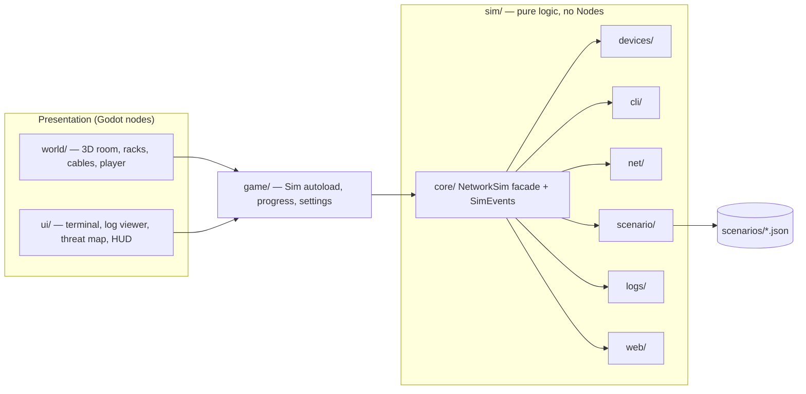

# NetSec 3D Simulator — Spec

A first-person 3D game where the player walks a server room, cables up network
gear, and fixes broken networks and insecure servers through an IOS-style
terminal. It teaches CCNA-level networking and entry-level security by doing.

This spec says **what** the game is and how it behaves. The order of work is in
[`IMPLEMENTATION_PLAN.md`](IMPLEMENTATION_PLAN.md). Detailed CLI grammar and the
scenario JSON schema live in the project skill references, which this spec
extends:

- [`.claude/skills/netsec-sim/references/ios-cli.md`](../.claude/skills/netsec-sim/references/ios-cli.md)
- [`.claude/skills/netsec-sim/references/scenario-schema.md`](../.claude/skills/netsec-sim/references/scenario-schema.md)

Where this spec and the skill disagree on scope or ordering, this spec wins.

---

## 1. Goals and non-goals

### Goals

1. **Teach by fixing.** Every mission starts broken. The player diagnoses and
   repairs it with real-world commands and concepts (VLANs, trunks,
   router-on-a-stick, log triage, SQLi/XSS fixes).
2. **Feel authentic.** CLI commands, prompts, abbreviations and error strings
   match Cisco IOS for the commands we support.
3. **Run on weak hardware.** Target: Intel HD Graphics 4000, 2 GB RAM. Low-poly,
   stylized art.
4. **Deterministic, tested core.** All network truth lives in a pure-logic sim
   core with headless unit tests. Same state + same input = same output.
5. **Portfolio quality.** Clean architecture, CI, a playable web demo, and a
   README that explains the design.

### Non-goals (v1)

- Real packets, real timing, packet loss, or real network access. Nothing
  leaves the game.
- STP, dynamic routing (OSPF, EIGRP), IPv6, DHCP.
- Multiplayer, voice, or a level editor.
- A full IOS clone. Only the commands the missions need.
- Copying the reference game's name, branding, or assets. It is inspiration
  only.

### Working title

`netsec-3d-simulator` is the repo name. The in-game title is TBD and must not be
"Network & Cyber Security Simulator".

---

## 2. Platform and stack

| Item | Choice | Why |
| --- | --- | --- |
| Engine | Godot 4.7, Standard edition | Free, Linux-friendly, strong UI tools, web export |
| Language | GDScript, static typing everywhere | Python-like; no C# toolchain needed for web export |
| Renderer | Compatibility | Required for HD 4000-class GPUs and web export |
| Tests | GdUnit4 under `res://tests/` | Headless runner for CI |
| Scenario format | JSON (built-in `JSON` class) | No addon needed |
| Exports | Windows, Linux, Web | Web build is the hosted demo |
| CI | GitHub Actions, Godot headless on Linux | Runs tests + purity check on every push |

### Performance budget (target hardware)

- 60 fps at 1280×720, 30 fps minimum at 1920×1080.
- Under 300 draw calls and 200k visible triangles in the server room.
- Under 1.5 GB RAM in use.
- No real-time shadows by default. Baked lighting or a single directional light.

---

## 3. Architecture

Three parts. Dependencies point inward only.



### 3.1 Sim core rules (`res://sim/`)

These are hard rules. CI fails if any are broken.

1. Classes extend `RefCounted` (or `Resource` for saved data). Never `Node`.
2. No `get_tree()`, `Input`, `OS.get_ticks_*`, `Time`, timers, `await`,
   `randf()`/`randi()`, or autoload references.
3. No imports from `world/`, `ui/` or `game/`.
4. All state changes go through `NetworkSim` methods, which emit typed signals
   on `SimEvents`.
5. Anything that looks like timing (ping delays, boot time, typing effects) is
   cosmetic and lives in the UI layer.

### 3.2 The `Sim` autoload (`res://game/sim.gd`)

- Owns exactly one `NetworkSim`.
- Loads a scenario, re-emits core signals, and exposes the core's public API to
  the presentation layer.
- The only path from `world/` and `ui/` into the core.

### 3.3 `NetworkSim` public API (v1)

| Method | Returns | Milestone |
| --- | --- | --- |
| `load_scenario(data: Dictionary)` | `LoadResult` (`ok`, `errors: Array[String]`) | M1 |
| `get_device(id: String)` | `Device` or `null` | M1 |
| `open_session(device_id: String)` | `CliSession` | M1 |
| `connect_link(a: String, b: String)` | `LinkResult` (`ok`, `reason`) | M1 |
| `disconnect_link(port: String)` | `LinkResult` | M1 |
| `ping(src_id: String, dst_ip: String)` | `PingResult` | M1 |
| `objective_states()` | `Array[ObjectiveState]` | M1 |
| `query_logs(source_id: String, file: String, filter: LogFilter)` | `Array[LogLine]` | M2 |
| `submit_report(field: String, value: String)` | `ReportResult` | M2 |
| `read_file(device_id: String, path: String)` | `String` or `null` | M3 |
| `write_file(device_id: String, path: String, text: String)` | `bool` | M3 |
| `http_request(src_id: String, url: String)` | `HttpResult` | M3 |

Ports are addressed as `"<device_id>:<canonical interface name>"`, for example
`"S1:FastEthernet0/1"`. Short names are normalized by `net/ifname.gd`.

### 3.4 Signals (`SimEvents`)

| Signal | Payload | Fired when |
| --- | --- | --- |
| `link_changed` | `a_port, b_port, connected: bool` | A cable is connected or removed |
| `interface_state_changed` | `port, oper_up: bool` | An interface's oper state flips |
| `config_changed` | `device_id` | Any CLI command changes device state |
| `file_changed` | `device_id, path` | A server file is saved (M3) |
| `report_submitted` | `field, correct: bool` | The player files a report field (M2) |
| `objective_updated` | `objective_id, passed: bool` | An objective's result changes |
| `mission_completed` | `scenario_id` | All objectives pass |

Objectives are re-evaluated after every `link_changed`, `config_changed`,
`file_changed` and `report_submitted`. They never poll.

---

## 4. Domain model (`sim/devices`)

As defined in the skill, summarized here.

| Class | Key state |
| --- | --- |
| `Device` | `id`, `hostname`, `interfaces: Dictionary[String, Interface]`, `enable_secret`, `users`, `vty_lines`, `domain_name`, `has_rsa_key` |
| `Router` | + `static_routes`, `nat_rules`, `acls`, `ip_routing = true` |
| `Switch` | + `vlans: Dictionary[int, String]` (VLAN 1 always exists). Ports have `mode`, `access_vlan`, `trunk_allowed` |
| `Host` | Single NIC: `ip`, `mask`, `gateway` |
| `Server` | A `Host` + `services`, `files`, `vulns` (M3) |
| `Interface` | `full_name`, `short_name`, `admin_up`, `ip`, `mask`, `peer` |
| Subinterface | An `Interface` + `parent`, `dot1q_vlan`; no `peer` |

- Physical interface **oper-up** = both ends `admin_up` and a cable exists.
- Subinterface **oper-up** = parent oper-up and itself `admin_up`.
- Host and server NICs are `admin_up` by default. Router interfaces start
  shut down, as on real IOS. Switch ports start up, in access mode, VLAN 1.
- A subinterface is created `admin_up`, as on real IOS, so its state follows
  its parent. Only the physical port needs `no shutdown`.

### Device model catalog (`sim/devices/models.gd`)

| Model | Type | Interfaces | 3D scene |
| --- | --- | --- | --- |
| `router_2port` | router | Gi0/0–Gi0/1 | `world/devices/router_2port.tscn` |
| `switch_24` | switch | Fa0/1–Fa0/24, Gi0/1–Gi0/2 | `world/devices/switch_24.tscn` |
| `pc` | host | Eth0 | `world/devices/pc.tscn` |
| `server` | server | Eth0 | `world/devices/server_1u.tscn` |

---

## 5. Terminal and CLI (`sim/cli`)

Full grammar, prompts and error strings: `references/ios-cli.md`. Key behavior:

- One `CliSession` per open terminal: device, mode stack, current
  interface/VLAN/line context, and command history.
- Unique-prefix abbreviation (`sh ip int br`, `conf t`).
- `?` help, Tab completion, `no` negation, and `do` from config modes, all
  handled by the `CommandRegistry`, not individual handlers.
- `show` output comes only from `cli/formatters.gd`, which is golden-tested.
- Ctrl+Z maps to `end`. Up/Down walks history.

### 5.1 Shells per device type

| Device | Shell | Commands (v1) |
| --- | --- | --- |
| Router, switch | IOS-style | Per milestone, see `ios-cli.md` |
| PC (`host`) | Mini Windows-style shell | `ipconfig`, `ipconfig /set <ip> <mask> <gw>`, `ping <ip>`, `curl <url>` (M3), `help` |
| Server | Mini Linux-style shell | `ls [path]`, `cat <file>`, `grep [-i] <pattern> <file>`, `tail [-n N] <file>`, `edit <file>` (M3), `service <name> status`, `help` |

The host and server shells are separate small command registries that share
the same help system as the IOS CLI. Their tokenizer also accepts a
double-quoted argument (`curl "http://10.0.10.5/login.php?user=' OR '1'='1"`),
which can hold spaces and single quotes. The IOS CLI keeps plain whitespace
splitting.

### 5.2 Ping output

- IOS devices: real IOS format (`Type escape sequence to abort.`, `!!!!!` or
  `.....`, `Success rate is N percent (x/5)`). Round-trip numbers are fixed
  values derived from hop count, so output is deterministic.
- PC: Windows-style `Reply from ...` / `Request timed out.` lines.
- The UI reveals ping characters one at a time for feel. The result is already
  decided by the core before the animation starts.

---

## 6. Connectivity (`sim/net`)

No real packets. `NetworkSim.ping(src_id, dst_ip)` runs a deterministic path
search and returns:

```gdscript
class_name PingResult extends RefCounted
var success: bool
var hops: Array[String]        # device ids, in order, forward path
var fail_reason: FailReason    # NONE when success
var fail_at: String            # device id or port where it failed, "" if none
```

### 6.1 Fail reasons

| Reason | Meaning | Milestone |
| --- | --- | --- |
| `NONE` | Success | M1 |
| `NO_IP` | Source has no IP address | M1 |
| `NO_LINK` | A needed cable is missing | M1 |
| `ADMIN_DOWN` | An interface on the path is shut down | M1 |
| `VLAN_MISMATCH` | L2 path exists but not in a shared VLAN / trunk doesn't carry it | M1 |
| `WRONG_SUBNET` | Host gateway is outside its own subnet | M1 |
| `NO_GATEWAY` | Off-subnet destination and no gateway set | M1 |
| `NO_ROUTE` | A router has no matching route | M1 |
| `HOST_UNREACHABLE` | Next hop or destination IP is not owned by any reachable device | M1 |
| `ACL_DENIED` | An ACL dropped the packet | M5 |

The reason must be precise: mission hints are keyed on it.

### 6.2 Resolution order

As in the skill: L1 oper-up → next-hop decision at each L3 device → L2 BFS
within one VLAN (access VLANs, trunk allowed lists, dot1Q subinterfaces) →
router pipeline (inbound ACL, NAT outside→inside, route lookup, NAT
inside→outside, outbound ACL) → the reply path must also resolve.

### 6.3 Required behavior

- Two hosts in the same VLAN and subnet ping each other with no router.
- Router-on-a-stick across a trunk works (M1 mission).
- A router pings from the IP of its egress interface.
- When several reasons apply, report the **first** one hit in resolution order,
  walking the forward path from the source.

---

## 7. Missions and scenarios (`sim/scenario`)

Each mission is one JSON file in `res://scenarios/<id>.json`. Base schema:
`references/scenario-schema.md`. The loader validates the whole file and
returns errors with JSON paths before any state is built.

### 7.1 v1 missions

| # | Id | Title (draft) | Teaches | New systems |
| --- | --- | --- | --- | --- |
| 1 | `m1_vlan_ping` | Day One: Get Them Talking | VLANs, access/trunk ports, router-on-a-stick | Sim core, IOS CLI, 3D room, cabling |
| 2 | `m2_log_triage` | Who Knocked? | Reading auth/web logs, spotting brute force, incident reporting | Logs, log viewer, report form, threat map |
| 3 | `m3_web_patch` | Patch Tuesday | SQL injection and reflected XSS, and how to fix them | Server files, code editor, simulated HTTP |

After v1: `m4_remote_access` (SSH + static routes) and `m5_nat_acl`
(static NAT + ACLs). Their CLI commands are already listed in `ios-cli.md`.

### 7.2 Mission flow

1. **Main menu** → mission select (locked until the previous mission is done).
2. **Briefing** card with the ticket text.
3. **Play**: walk, cable, configure. The HUD lists objectives with live
   pass/fail ticks.
4. **Hints**: when a `ping` objective fails, the HUD can show the hint matching
   its `fail_reason`. A hint appears only after the player presses the hint
   key, so it never spoils the puzzle by default.
5. **Debrief**: when all objectives pass, show a summary of what was fixed
   and the commands a real admin would use. Progress is saved.

### 7.3 Objective types

| Type | Params | Passes when | Milestone |
| --- | --- | --- | --- |
| `ping` | `from`, `to_ip`, `to_device` (optional), `via` (optional) | Ping succeeds; if `to_device` is set, that device owns `to_ip` and is the last hop; if `via` is set, that device is on the forward path | M1 |
| `config` | `device`, `path`, `equals` | Config value matches | M1 |
| `report` | `field`, `equals` | The player's filed value for `field` matches (case-insensitive, trimmed) | M2 |
| `vuln_patched` | `device`, `vuln` | The vuln's `patched_when` checks pass **and** its service is healthy | M3 |
| `service_up` | `device`, `service` | The service's `healthy_when` checks pass | M3 |
| `no_ping` | `from`, `to_ip`, `expect_reason` | Ping fails with exactly that reason | M5 |
| `ssh` | `from`, `to_ip`, `user` | SSH preconditions + L3 reachability | M4 |

**Anti-cheese rules.** Any "it stops working" objective must name what it
expects (`no_ping.expect_reason`) and be paired with a "still works"
objective. A `ping` objective names its target with `to_device`, so giving
`to_ip` to some other device (for example a router subinterface) does not
pass. A `ping` objective that teaches routing also sets `via` to the router,
so re-addressing both hosts into one subnet and VLAN (a pure L2 path) does
not pass. When `via` is set and the ping succeeds without it, the HUD says
"reached, but not through <via>". `vuln_patched` includes the service
health check, so deleting the
vulnerable file or stopping the web service does not pass.

### 7.4 Schema additions for M2 (logs and reports)

```json
"logs": [
  {
    "source": "WEB1",
    "file": "/var/log/auth.log",
    "lines": [
      { "t": "2026-03-14T02:11:05Z", "text": "sshd[811]: Failed password for root from 203.0.113.45 port 51122 ssh2", "src_ip": "203.0.113.45", "geo": "NL" }
    ]
  }
],
"report": {
  "fields": [
    { "id": "attacker_ip", "label": "Attacker IP", "kind": "ipv4" },
    { "id": "attack_type", "label": "Attack type", "kind": "choice",
      "options": ["Brute force", "SQL injection", "Port scan", "Phishing"] },
    { "id": "compromised_user", "label": "Compromised account", "kind": "text" }
  ],
  "max_attempts": 3
}
```

- Log lines are static data with timestamps written in the file. The core
  never reads the clock.
- `src_ip` and `geo` (ISO 3166 alpha-2) are optional. They feed the threat map.
- Lines are shown in file order. `t` is display-only.
- `report.max_attempts` (default 3) limits wrong submissions per field. When a
  field runs out, its objective fails for good and the debrief shows the
  answer. The mission can be restarted.
- Validator: every `report` objective's `field` must exist in `report.fields`;
  a `choice` objective's `equals` must be one of its `options`; each log
  `source` must be a device id.

### 7.5 Schema additions for M3 (files, services, vulns)

```json
{
  "id": "WEB1", "type": "server", "model": "server", "hostname": "web1",
  "rack": "rack_a", "slot": 5,
  "config": {
    "ip": "10.0.10.5", "mask": "255.255.255.0", "gateway": "10.0.10.1",
    "files": {
      "/var/www/login.php": "<?php\n$user = $_POST['user'];\n$q = \"SELECT * FROM users WHERE name = '\" . $user . \"'\";\n..."
    },
    "services": [
      { "id": "http", "port": 80, "root": "/var/www",
        "healthy_when": [
          { "file": "/var/www/login.php", "must_match": ["function\\s+check_login\\s*\\("] }
        ] }
    ],
    "vulns": [
      { "id": "sqli_login", "kind": "sqli", "service": "http",
        "file": "/var/www/login.php", "route": "/login.php",
        "patched_when": [
          { "file": "/var/www/login.php",
            "must_match": ["->prepare\\s*\\(\\s*[\"'][^\"']*\\?",
                           "->execute\\s*\\(\\s*\\[\\s*\\$user\\s*\\]\\s*\\)"],
            "must_not_match": ["(?i)(SELECT|INSERT|UPDATE|DELETE)[^;]*\\$",
                               "->query\\s*\\(", "\\.=\\s*\\$"] }
        ],
        "bypass_fixtures": [
          "<?php ... $q = \"SELECT * FROM users WHERE name = '$user'\"; // ->prepare( ...",
          "<?php ... $st = $db->prepare('SELECT 1 WHERE ?'); $db->query(\"SELECT ... '\" . $user . \"'\");"
        ],
        "exploit": { "param": "user", "payload": "' OR '1'='1",
                     "vulnerable_body": "Welcome, admin!", "patched_body": "Login failed." } }
    ]
  }
}
```

- `files` holds short source files (under 60 lines each). Code is PHP-flavored
  pseudo-code, since PHP is the classic teaching example for SQLi and XSS.
- A check passes when every `must_match` regex matches and no
  `must_not_match` regex matches. Regexes use Godot's `RegEx` (deterministic,
  `RefCounted`, allowed in the core).
- Checks run on the file **with comments stripped** (`//`, `#` and `/* */`
  outside string literals, for `.php` files), so a commented-out
  `->prepare(` does not count.
- Regex checks are a heuristic, not a parser. Each vuln therefore lists
  `bypass_fixtures`: known-bad patches (string interpolation, an unused or
  commented `prepare`, an unprepared `->query(`) that must **not** read as
  patched. The validator runs them at load time and rejects the scenario if
  any fixture passes. Every bypass found in playtesting becomes a new
  fixture.
- The validator compiles every regex at load time and rejects bad ones. It
  also runs the checks against the **starting** files and rejects a scenario
  where a vuln already reads as patched or a service already reads as
  unhealthy.
- The smoke test's `solution` gains a step type:
  `{ "device": "WEB1", "write_file": { "path": "...", "text": "..." } }`.

### 7.6 Simulated HTTP (M3)

`NetworkSim.http_request(src_id, url)` lets the player test an exploit from a
PC with `curl`:

1. Parse the URL (`http://<ipv4>[:port]/<route>?<query>`). Query values are
   URL-decoded (`%27` → `'`, `+` → space) before any comparison, so a quoted
   raw payload and a percent-encoded one behave the same.
2. Resolve L3 reachability with the ping resolver. On failure, print a
   curl-style error, for example `curl: (7) Failed to connect to 10.0.10.5 port 80`.
3. Find the service on that port. None → connection refused.
4. If the route matches a vuln and the decoded `param` value equals its
   exploit payload (trimmed),
   return `vulnerable_body` or `patched_body` based on the vuln's state.
5. Otherwise return a fixed `200 OK` page for the route.

No real HTTP is sent. It is a lookup over sim state.

---

## 8. Presentation layer

### 8.1 World (`res://world/`)

- **Room:** one low-poly server room with 2 racks, 2 desks, and a wall
  monitor. Built from free assets (Kenney, Quaternius, Poly Haven textures)
  plus simple Blender racks/switches.
- **Spawning:** `world/room_builder.gd` reads the loaded scenario through
  `Sim` and instantiates each device's model scene at its `rack`/`slot` or
  `desk` marker (`Marker3D` nodes in the room scene).
- **Port sockets:** each model scene has ordered socket markers. The spawner
  assigns `device_id` and canonical interface names from `models.gd`, in
  order. Names are never typed into scenes by hand.
- **Port LEDs:** off (no cable), amber (cable, not oper-up), green (oper-up).
  They react to `interface_state_changed`.
- **Player:** `CharacterBody3D` with WASD + mouse look, crouch, and an
  interact raycast. A crosshair prompt names the target ("Fa0/2 — S1",
  "Open console").

### 8.2 Cabling

1. Look at a free socket and press interact to pick up a cable end. This uses
   one of `spare_cables`.
2. Look at a second free socket and press interact. The world calls
   `Sim.connect_link(a, b)`.
3. If the sim accepts, a cable mesh is drawn between the sockets with a
   simple sag curve. If it rejects (port in use, same device), the cable end
   returns and a toast shows the reason.
4. Interact on an unlocked plugged cable unplugs it and returns it to the
   spare count. Locked cables can't be unplugged.
5. Press cancel to drop a held cable end.

The 3D cable is only a view of sim state. On `link_changed` the world adds
or removes cable meshes to match.

### 8.3 UI (`res://ui/`)

| Screen | Contents | Milestone |
| --- | --- | --- |
| Terminal | Full-screen monospace console bound to a `CliSession`. Esc closes. Shows the device hostname in the title bar | M1 |
| Mission HUD | Objective list with ticks, spare cable count, hint key prompt | M1 |
| Briefing / debrief | Ticket-style cards | M1 |
| Main menu + mission select | Locked/unlocked missions, settings | M1 (single mission), M2 (select) |
| Log viewer | Opened from the SOC desk monitor. File list, scrolling view, text filter, highlight on match | M2 |
| Report form | Fields from `report.fields`; shows remaining attempts | M2 |
| Threat map | 2D world map; arcs from `geo` countries for log lines with `src_ip`; click an arc to jump to the line | M2 (should-have) |
| Code editor | `CodeEdit` with line numbers and basic PHP highlighting; Save calls `Sim.write_file` | M3 |

UI scripts read state only through `Sim` and react to its signals. No UI
script stores its own copy of network truth.

### 8.4 Input map

| Action | Default |
| --- | --- |
| Move | WASD |
| Look | Mouse |
| Interact | E / left click |
| Cancel / close | Esc |
| Hint | H |
| Objectives toggle | Tab (outside terminal) |
| Crouch | Ctrl |

### 8.5 Saving

`game/progress.gd` saves completed mission ids and settings to
`user://progress.json`. Mid-mission state is not saved in v1. Leaving a
mission restarts it.

---

## 9. Testing

- **Unit (GdUnit4, headless):** everything under `sim/`. Suites mirror the
  folder layout under `res://tests/`.
- **CLI commands:** each one is tested for parsing (including
  abbreviations), state change, and `show` output against golden strings.
- **Connectivity:** same-subnet no-router; router-on-a-stick; each M1 fail
  reason; reply-path failure; first-reason-wins ordering.
- **Objectives:** a passing case and each documented failing case per type.
- **Scenarios:** a smoke test per file: load, apply `solution`, assert all
  objectives pass. Plus: the unsolved starting state has at least one
  objective failing.
- **Purity check:** `tools/check_sim_purity.sh` greps `sim/` for
  `extends Node`, `get_tree`, `Input.`, `randf`, `randi`, `await`, `Time.`,
  `OS.get_ticks`. Any hit fails CI.
- **Manual playtest checklist** per mission, kept in
  `docs/playtest/<mission>.md`.

Run tests:

- Linux/macOS: `addons/gdUnit4/runtest.sh -a res://tests`
- Windows: `addons\gdUnit4\runtest.cmd -a res://tests`

(Check the installed GdUnit4 version's docs if the path differs.)

---

## 10. Future work (after v1)

- **M4 Remote access & routing:** SSH setup, static routes, `show ip route`.
- **M5 NAT & ACLs:** static NAT, standard ACLs, `no_ping` objectives. Retrofit
  M2 with an optional "block the attacker with an ACL" bonus objective.
- **Real backend (stretch):** a `NetworkBackend` interface so a terminal can
  attach to real FRRouting or VyOS containers in a homelab instead of the sim.
  The core stays the default backend.
- More missions: DHCP starvation, ARP spoofing, firewall rules, phishing
  triage.

---

## 11. Open questions

- Final game title and art direction (colors, UI theme).
- Whether the threat map ships in v1 or slides to v1.1.
- Hosting for the web demo (itch.io vs GitHub Pages).
- Whether hints cost score, or are free.
